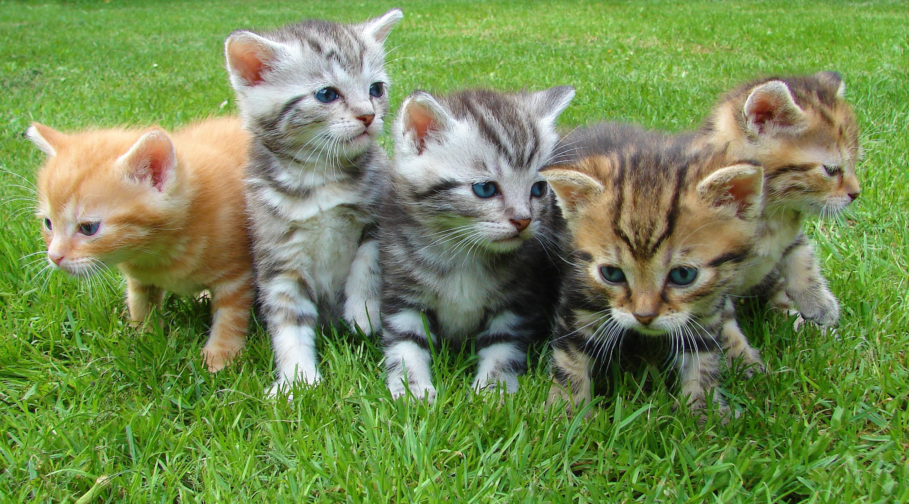
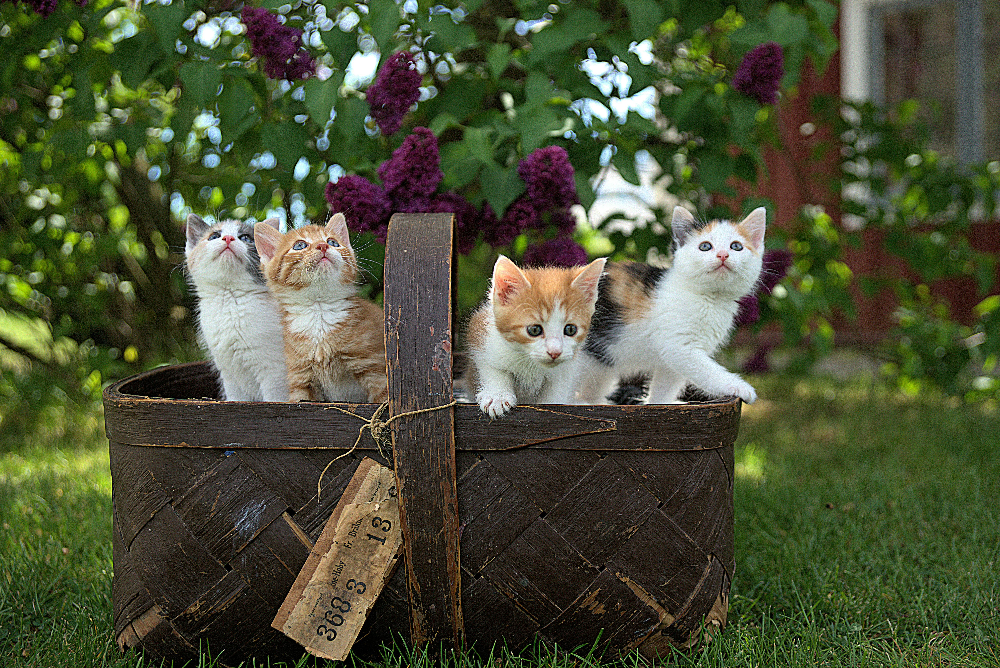
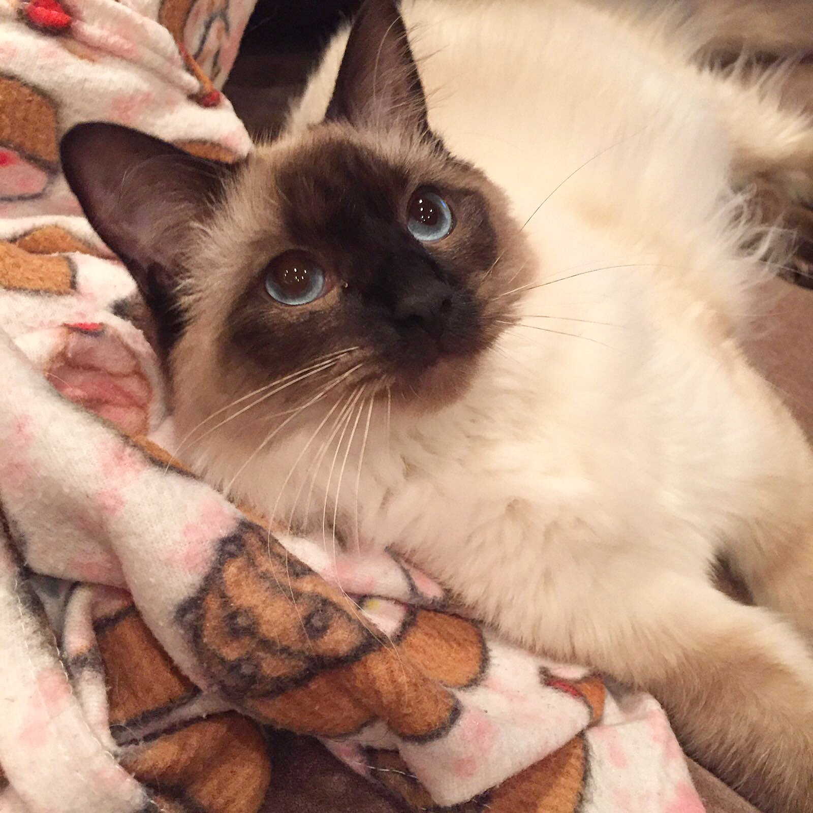
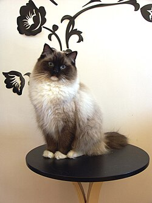
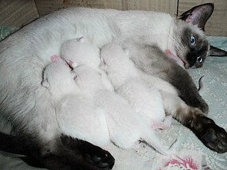
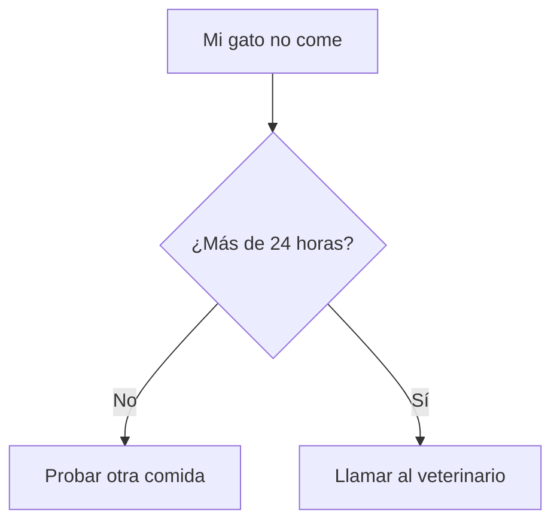
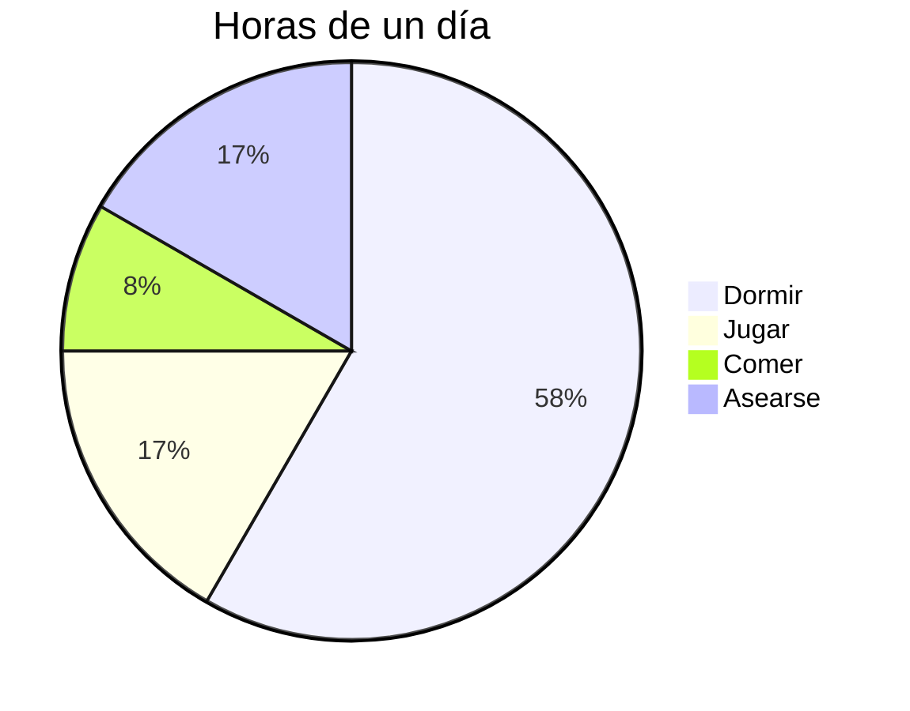
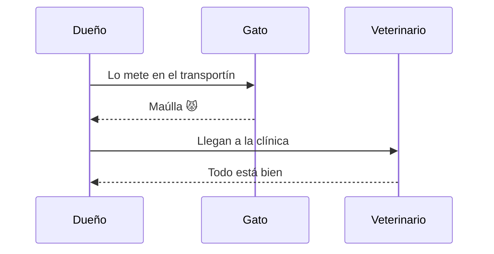
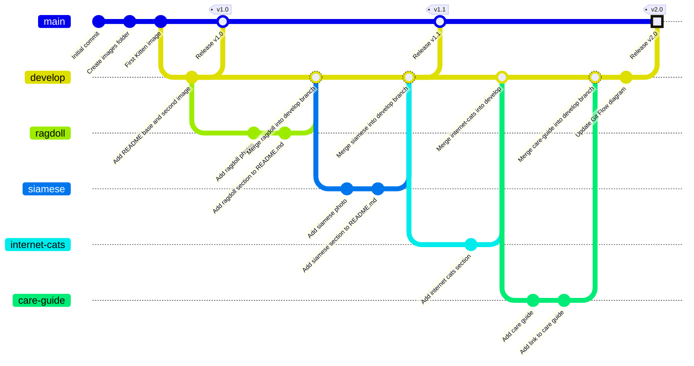

$$
\Huge \color{#792d37}{\textbf{azael-kitties-guide}}
$$

<!-- Portada: foto de una camada de gatitos de Wikimedia Commons -->



Foto: **Jan-Mallander**, *CC0*, via [Wikimedia Commons](https://commons.wikimedia.org/wiki/File:Litter_of_kittens.jpg "Ver la foto original en Wikimedia Commons")

<a id="indice"></a>

## 📑 Índice

1. [Introducción](#introduccion)
2. [Razas de gatos](#-razas-de-gatos)
3. [Cuidados](#-cuidados)
4. [Crecimiento y alimentación](#-crecimiento-y-alimentación)
5. [Comportamiento](#-comportamiento)
6. [Curiosidades](#-curiosidades)
7. [Historial del proyecto](#-historial-del-proyecto)

---

<a id="introduccion"></a>

# 🐱 Introducción

## ¿Por qué michis/gatos? 🐾

Los gatos duermen ~~2 horas~~ **entre 12 y 16 horas** al día, son *independientes* y siempre tienen ***hambre***.

> El sistema de distribución de gatos funciona de tal forma que
> cuando el destino quiera que cuides a un gato, te aparecerá
> en la calle y tu deber será acogerlo, darle mimos, comida y todo lo que necesite
> durante toda su vida 😹
>
> — Azael

Este *miau*-párrafo tiene saltos de línea. <br>
Esta línea *gatuna* usa la etiqueta `<br>`. \
Esta *miau*-línea usa la barra invertida.  
Y esta última línea usa dos espacios al final de la línea anterior *meow*.

---

## Sobre esta guía

Esta guía habla de razas, cuidados, alimentación y curiosidades de los gatos. \
**Demos comienzo entonces a mi proyecto de CMD** *(Cats MarkDown)*. 😻



Foto: **Jari Hytönen**, en [Unsplash](https://unsplash.com/es/fotos/cuatro-gatitos-atigrados-de-colores-variados-en-una-canasta-marron-YCPkW_r_6uA?utm_source=unsplash&utm_medium=referral&utm_content=creditCopyText "Ver la foto original en Unsplash")

### ¿Para quién es?

- 🐱 Para quien quiera adoptar un gatito
- 🧶 Para quien ya tenga gato
    - Y tenga ganas de aprender más cosas

> [!NOTE]
> ***Esta guía es para los amantes de los gatitos***

Si desea más información: [Wikipedia](https://es.wikipedia.org/wiki/Gato "Artículo del gato en Wikipedia").

[⬆️ Volver al índice](#indice)

---

# 🐈 Razas de gatos

## Tabla de razas

| Raza       | Origen    | Peso (kg) |
|:-----------|:---------:|----------:|
| Ragdoll    | EE. UU.   |   4,5 - 9 |
| Siamés     | Tailandia | 2,5 - 5,5 |
| Maine Coon | EE. UU.   |     4 - 8 |

> [!NOTE]
> Los pesos son aproximados.

## Ragdoll

- Carácter:
  - Tranquilo
  - Cariñoso
- Pelo semilargo y suave
- Se les llama *Ragdoll* porque al levantarlos se quedan flojos y relajados.



Foto: [**TeeDee48**](https://commons.wikimedia.org/wiki/File:Male_ragdoll_cat.jpg "Enlace a imagen del autor"), [*CC BY-SA 4.0*](https://creativecommons.org/licenses/by-sa/4.0/ "Enlace a la licencia de Creative Commons 4.0"), via Wikimedia Commons



Foto: [**CalistaZ**](https://commons.wikimedia.org/wiki/File:Female_ragdoll.jpg "Ver la foto original en Wikimedia Commons"), [CC BY-SA 3.0](https://creativecommons.org/licenses/by-sa/3.0/ "Enlace a la licencia de Creative Commons 3.0"), via Wikimedia Commons

## Siamés

1. Habla mucho
2. Tiene los ojos azules
   1. Orejas oscuras
   2. Cola oscura



Foto: [**S zillayali**](https://commons.wikimedia.org/wiki/File:Siamese_Cat_with_her_Kitties.jpg "Ver la foto original en Wikimedia Commons"), [CC BY-SA 3.0](https://creativecommons.org/licenses/by-sa/3.0/ "Enlace a la licencia de Creative Commons 3.0"), via Wikimedia Commons

<!-- Aquí se podrían añadir más razas en el futuro si quisiera ampliar -->

## Gatos de Internet 🌐


Foto: [**Leijurv**](https://commons.wikimedia.org/wiki/File:Ragdoll_Cat_Stretching.jpg "Ver la foto original en Wikimedia Commons"), [CC BY-SA 4.0](https://creativecommons.org/licenses/by-sa/4.0/ "Enlace a la licencia de Creative Commons 4.0"), via Wikimedia Commons


Foto: [**Andy Burgess**](https://commons.wikimedia.org/wiki/File:Ragdoll_%284200198725%29.jpg "Ver la foto original en Wikimedia Commons"), [CC BY 2.0](https://creativecommons.org/licenses/by/2.0/ "Enlace a la licencia de Creative Commons 2.0"), via Wikimedia Commons

[⬆️ Volver al índice](#indice)

---

# 🧶 Cuidados

## Lista de tareas para un gatito nuevo

- [x] Ir al veterinario 🩺
- [x] Comprar una cama 🛏️
- [x] Comprar cuencos de comida y agua
- [ ] Comprar un arenero
- [ ] Comprar un rascador

> [!TIP]
> Pon el arenero lejos de la comida.

Hay más información en la [guía de cuidados](docs/care.md "Abrir la guía de cuidados").

## Vacunas 💉

| Edad       |    Vacuna    |
|:-----------|:------------:|
| 8 semanas  |  Trivalente  |
| 12 semanas |    Refuerzo  |
| Cada año   |    Refuerzo  |

> [!WARNING]
> No des medicinas de personas a tu gato.

## Comida 🍗

| Alimento       | Permitido |
|:---------------|----------:|
| Pollo cocinado |        ✅ |
| Pescado cocido |        ✅ |
| Chocolate      |        ❌ |
| Cebolla        |        ❌ |

## Rascador y caja

Un rascador cilíndrico de radio $r$ y altura $h$ tiene una superficie lateral:

$$
A = 2\pi r h
$$

Una caja de cartón tiene un volumen $V = l \cdot a \cdot h$.

## ¿Qué hago si mi gato no come? 😿



Para ver el estado de su michi se usa `git status` o equivalente a `llevarlo al veterinario`.

[⬆️ Volver al índice](#indice)

---

# 🍗 Crecimiento y alimentación

## Calorías al día

La energía en reposo (RER) de un gato de $P$ kilos es:

$$
RER = 70 \times P^{0.75}
$$

Ejemplo en Python para un gato de 4 kg:

```python
peso = 4  # kilos
rer = 70 * peso ** 0.75
print("Calorías en reposo:", round(rer))
```

Resultado:

```text
Calorías en reposo: 198
```

## Crecimiento

Un gatito gana unos 100 gramos por semana. Si $t$ son las semanas y $p_0$ el peso al nacer:

$$
p = p_0 + 100\,t
$$

## Edad de un gato

Para un gato de $a \ge 2$ años, su edad humana es $H = 24 + 4(a-2)$. Por ejemplo, con 5 años son $24 + 4 \cdot 3 = 36$ años humanos. 🎂

## Ficha de un gato

```json
{
  "nombre": "Miauhla",
  "raza": "Ragdoll",
  "edad": 2,
  "vacunado": true
}
```

[⬆️ Volver al índice](#indice)

---

# 😸 Comportamiento

## Lenguaje corporal 🐾

- **Cola hacia arriba:** está contento
- **Orejas hacia atrás:** tiene miedo o está enfadado
- **Parpadeo lento:** confía en ti 😌

## Un día de un gato



## Dueño, gato y veterinario



## Citas sobre gatos

> "Si el hombre pudiera cruzarse con el gato, mejoraría el hombre, pero empeoraría el gato."
>
> — Mark Twain (traducción)

> "El felino más pequeño es una obra maestra."
>
> — Atribuida a Leonardo da Vinci

[⬆️ Volver al índice](#indice)

---

# 🔍 Curiosidades

## ¿Sabías que...? 😻

<details>
<summary>🔊 ¿Cómo suena el ronroneo?</summary>

Es como si escucharas un motor, con una vibración entre 25 y 150 Hz.

</details>

<details>
<summary>🦴 ¿Cuántos huesos tiene?</summary>

Los gatitos tienen aproximadamente 230 huesitos.

</details>

## Pausa de gatitos con etiquetas HTML

- Pulsa <kbd>Ctrl</kbd> + <kbd>C</kbd> para copiar.
- El agua es <b>H<sub>2</sub>O</b>.
- Mi gato es el 1<sup>º</sup> de la casa 🐾
- <ins>cama para gatos</ins>

## Probabilidad gatuna

Si una camada tiene 4 gatitos, la probabilidad de que todos sean hembras se puede calcular mediante la siguiente fórmula:

$$
P = \left(\frac{1}{2}\right)^4 = \frac{1}{16}
$$

[⬆️ Volver al índice](#indice)

---

# 🌿 Historial del proyecto

Este repositorio usa **Git Flow**: una rama por cada raza y una etiqueta por versión. 🌿

## Comandos

```bash
git checkout -b ragdoll
git add README.md
git commit -m "Añadir ragdoll"
git checkout main
git merge ragdoll
git tag v1.0
```

## Diagrama de ramas



Proyecto hecho por **Azael Reyes Martel**. Puedes ver el código en el [repositorio de GitHub](https://github.com/AzaelReyesMartel-1ASIR/azael-kitties-guide "Ir al repositorio del proyecto")

[⬆️ Volver al índice](#indice)